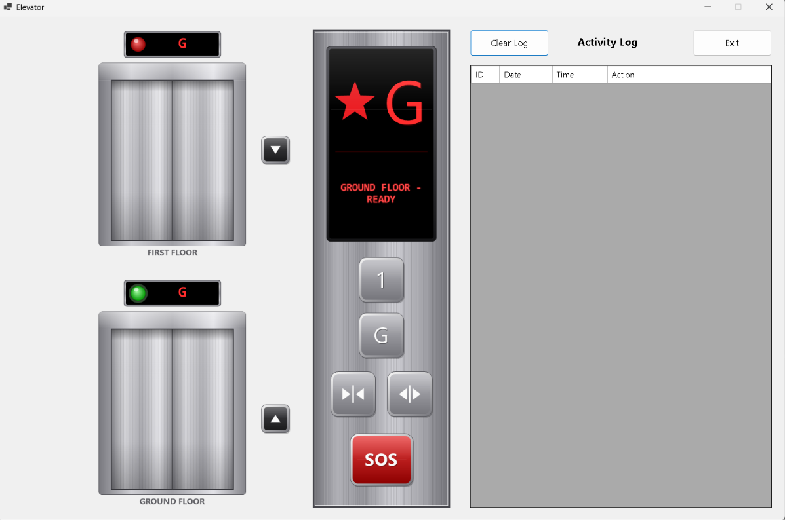
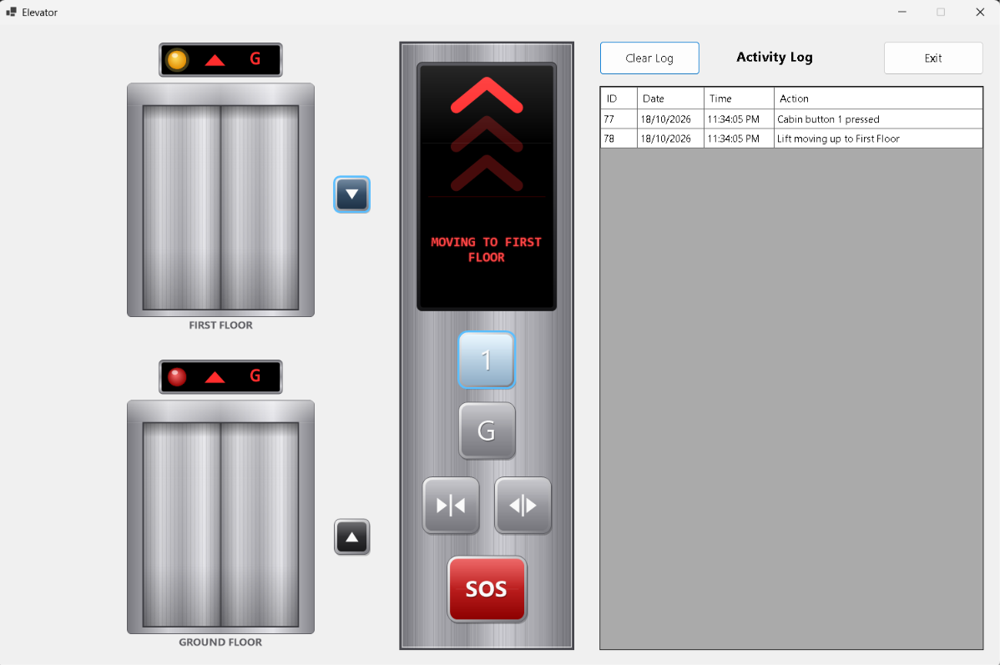
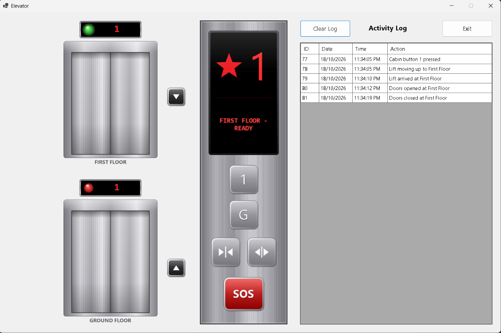
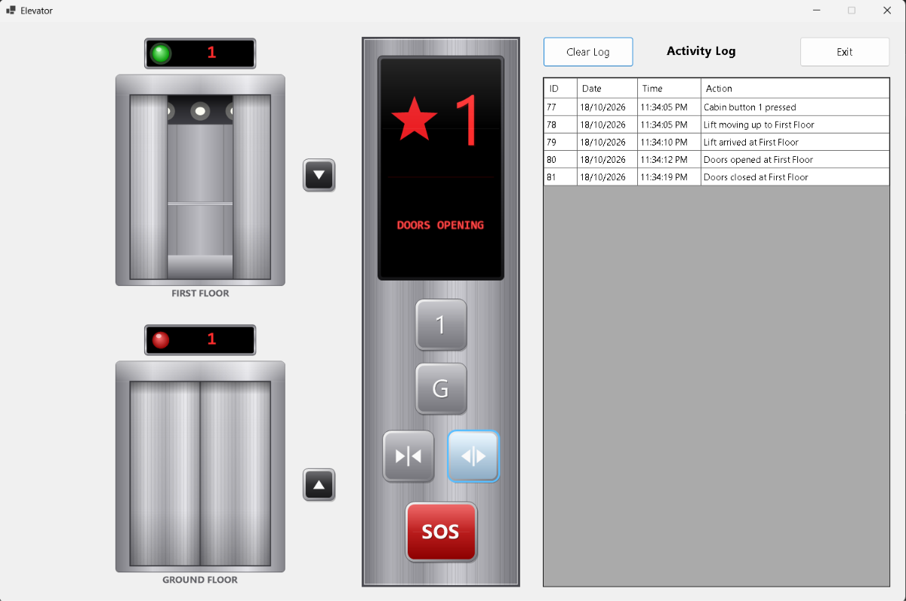
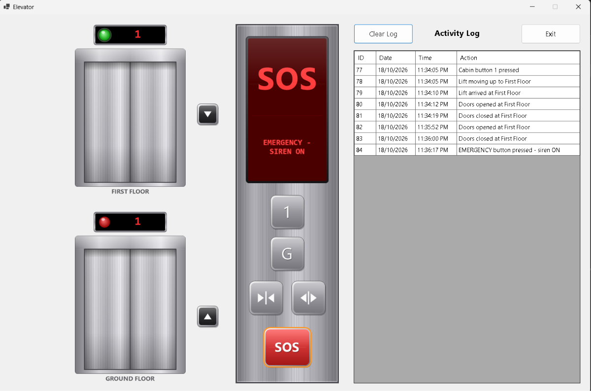

# 🛗 Elevator Control System

A realistic **two-floor lift (elevator) simulator** for Windows, built with **C# (.NET) Windows Forms** and **SQL Server**.
It has animated metal doors, a control panel with an LED display, working sounds (moving hum, arrival ding and a loud emergency siren), and an **activity log stored in a SQL Server database**.



---

## ✨ Features

| Area | What it does |
|---|---|
| **Realistic doors** | Two steel doors (First floor and Ground floor) that slide open and closed. When open you can see the cabin interior (ceiling lights, handrail, floor). |
| **Lift-present light** | A lamp above each door: 🟢 green = lift is here, 🟡 amber (blinking) = lift is arriving, 🔴 red = lift is not here. A small display next to it shows the lift's current floor and a direction arrow. |
| **LED display** | Big LED screen on the control panel: current floor, animated arrows while moving, and messages such as `MOVING TO FIRST FLOOR`, `DOORS OPEN`, `EMERGENCY - SIREN ON`. |
| **Control panel** | Buttons for floor `1` and `G`, **Open door**, **Close door** and a red **SOS (emergency)** button. Buttons light up when a request is pending. |
| **Call buttons** | ▲ / ▼ buttons beside the doors call the lift to that floor. |
| **Sounds** | Moving hum while travelling, a "ding" on arrival, and a loud siren during an emergency. All sounds are generated in code, so no audio files are needed. |
| **Emergency mode** | Pressing SOS starts the siren and halts the lift. Floor requests are ignored until you press SOS again. |
| **Door safety sensor** | If the mouse cursor is in the doorway while the doors are closing, they **reopen** (like a real door sensor). |
| **Activity log** | Every action is saved to SQL Server and shown in a grid with the columns **ID, Date, Time, Action**. Includes **Clear Log** and **Exit** buttons. |
| **Automatic database setup** | The app creates the database and table by itself on first start. |

---

## 🎬 Demo video

See the simulator running from start to finish: starting the app, calling the lift, doors opening and closing, the moving sound, the emergency siren and the activity log filling up in real time.

[](screenshots/Lift_Simulator_Video.mp4)

**[▶ Click here to watch the full demo (MP4)](screenshots/Lift_Simulator_Video.mp4)**

> 💡 If the video opens as a download instead of playing, click the **Download raw file** button on the GitHub page and play it on your computer. Turn the sound on to hear the moving hum and the siren.

---

## 📸 Screenshots

| Ground → First floor | Lift arrived at First floor |
|:---:|:---:|
|  |  |
| The LED shows the moving arrows and `MOVING TO FIRST FLOOR`; the amber lamp blinks above the destination door. | The doors open on the First floor, the lamp above that door turns green, and the arrival is saved in the log. |

| Door open button clicked | Emergency button clicked |
|:---:|:---:|
|  |  |
| The doors slide open and the cabin interior becomes visible. | The SOS button flashes, the siren plays and the LED shows the emergency message. |

---

## 🧰 Tech stack

- **Language:** C#
- **Framework:** .NET, Windows Forms (custom-drawn GDI+ controls)
- **Database:** SQL Server (LocalDB, SQL Server Express or full SQL Server)
- **Data access:** ADO.NET with `Microsoft.Data.SqlClient`
- **Configuration:** `app.config` via `System.Configuration.ConfigurationManager`
- **Sound:** `System.Media.SoundPlayer` with WAV data generated at runtime

> ⚠️ **Windows only.** Windows Forms and `SoundPlayer` do not run on macOS or Linux.

---

## 📋 Requirements

- Windows 10 or Windows 11
- [Visual Studio 2022 or newer](https://visualstudio.microsoft.com/) with the **.NET desktop development** workload
- **SQL Server LocalDB** (installed with the Visual Studio *Data storage and processing* workload) **or** SQL Server Express / Developer
- *(Optional)* [SQL Server Management Studio (SSMS)](https://learn.microsoft.com/sql/ssms/download-sql-server-management-studio-ssms) to view the log table

---

## 🚀 Getting started (step by step)

### 1. Clone the repository

```bash
git clone https://github.com/Melan-Parajuli7/Lift-App.git
cd Lift-App
```

*(Use the URL of your own copy or fork if it is different.)*

### 2. Open the solution

Double-click **`ElevatorApp.csproj`** to open the project in Visual Studio.

### 3. Restore the NuGet packages

Visual Studio normally restores packages automatically when you build. If it does not, open **Tools → NuGet Package Manager → Package Manager Console** and run:

```powershell
Install-Package Microsoft.Data.SqlClient
Install-Package System.Configuration.ConfigurationManager
```

### 4. Set the database connection string

Open **`app.config`**. The default uses **LocalDB**:

```xml
<connectionStrings>
  <add name="ElevatorDb"
       connectionString="Server=(localdb)\MSSQLLocalDB;Database=ElevatorDB;Integrated Security=True;Encrypt=True;TrustServerCertificate=True;" />
</connectionStrings>
```

Change the `Server=` part if you use something else:

| SQL Server type | `Server=` value |
|---|---|
| LocalDB (default) | `(localdb)\MSSQLLocalDB` |
| SQL Server Express | `.\SQLEXPRESS` |
| Full SQL Server on this PC | `localhost` |
| SQL Server login instead of Windows login | replace `Integrated Security=True` with `User Id=yourUser;Password=yourPassword` |

> 💡 Do not commit real passwords to GitHub.
> You do **not** have to create the database yourself: the `ElevatorDB` database and the `LiftLogs` table are created automatically the first time the app starts.

### 5. Build and run

1. **Build → Rebuild Solution**
2. Press **F5**

The first start may take a few seconds while the database is created.

---

## 🎮 How to use the app

| Control | What it does |
|---|---|
| **`1`** / **`G`** (control panel) | Send the lift to the First floor or the Ground floor. |
| **▲ / ▼** (beside the doors) | Call the lift to the floor where you are standing. |
| **Close-door button** (▶\|◀) | Close the doors now. |
| **Open-door button** (◀\|▶) | Open the doors, or keep them open longer. |
| **SOS** (red) | Start the siren and halt the lift. Press **again** to cancel the emergency. |
| **Mouse in the doorway** | While the doors are closing, the safety sensor reopens them. |
| **Clear Log** | Deletes all rows from the log table. |
| **Exit** | Closes the application. |

**Try this:**
1. Start the app. The lift is at the Ground floor and the green lamp is lit above the bottom door.
2. Click **`1`**. The doors close, the LED shows `MOVING TO FIRST FLOOR` with animated arrows, and you hear the moving hum.
3. The lift arrives, you hear a ding, and the top door opens (green lamp on top, red lamp at the bottom).
4. Click **SOS** while it is moving to hear the siren. Click it again to cancel.
5. Watch the **Activity Log** on the right fill with entries.

---

## 🗄️ Database

The app uses one table, `dbo.LiftLogs`:

| Column | Type | Description |
|---|---|---|
| `Id` | `INT IDENTITY` | Primary key |
| `LogDate` | `DATE` | Date of the action |
| `LogTime` | `TIME(0)` | Time of the action |
| `ActionText` | `NVARCHAR(200)` | What happened |

Example log entries:

```
Application started - lift at Ground Floor
Cabin button 1 pressed
Doors closed at Ground Floor
Lift moving up to First Floor
Lift arrived at First Floor
Doors opened at First Floor
EMERGENCY button pressed - siren ON
Door obstruction detected at First Floor - doors reopening
```

**View the data in SSMS:** connect to `(localdb)\MSSQLLocalDB` with Windows Authentication, expand **Databases → ElevatorDB → Tables**, right-click `dbo.LiftLogs` and choose **Select Top 1000 Rows**.

If you prefer to create the database manually, run [`data/CreateTables.sql`](data/CreateTables.sql) in SSMS.

---

## 📁 Project structure

```
Lift-App/
├── README.md
├── ElevatorApp.csproj             Project file
├── Program.cs                     Application entry point
├── app.config                     SQL Server connection string
│
├── enums/
│   ├── Floor.cs                   Ground / First
│   ├── LiftDirection.cs           None / Up / Down
│   └── DoorPhase.cs               Closed / Opening / Open / Closing
│
├── models/
│   └── LogEntry.cs                One row of the activity log
│
├── helpers/
│   ├── FloorExtensions.cs         "G" / "1" labels and floor names
│   └── Gfx.cs                     Drawing helpers (rounded rectangles, metal gradients)
│
├── data/
│   ├── DbConnectionFactory.cs     Reads app.config and creates SQL connections
│   ├── DbInitializer.cs           Creates the database and table automatically
│   └── CreateTables.sql           Optional manual SQL script
│
├── repo/
│   ├── ILogRepository.cs          Log storage contract
│   └── LogRepository.cs           SQL queries: add, read and clear the log
│
├── services/
│   ├── LiftController.cs          Lift logic: movement, doors, emergency (no UI code)
│   └── SoundService.cs            Generates and plays siren, hum and ding
│
├── controls/
│   ├── DoorControl.cs             Door frame, sliding doors, cabin, lamp and floor display
│   ├── LedDisplay.cs              LED screen on the control panel
│   ├── PanelButton.cs             Metal buttons with glow
│   └── MetalPanel.cs              Brushed-steel control panel
│
├── forms/
│   ├── MainForm.cs                Window logic and button handlers
│   └── MainForm.Designer.cs       Window layout
│
└── screenshots/                   Images and the demo video used in this README
```

### How the pieces fit together

```
MainForm  ──►  LiftController  (decides what the lift does, raises events)
   │                │
   │                └─ events: Changed, Logged, MovementChanged, EmergencyChanged
   │
   ├──►  Custom controls  (DoorControl, LedDisplay, PanelButton)  draw the state
   ├──►  SoundService     plays siren / hum / ding
   └──►  LogRepository ──► SQL Server (LiftLogs table)
```

`LiftController` contains the lift rules and has no UI code, so it is easy to read and test on its own.

---

## ⚙️ Customising

Open `services/LiftController.cs` and change the constants at the top:

| Constant | Default | Meaning |
|---|---|---|
| `TravelMs` | `3000` | Time to travel between the two floors (ms) |
| `DoorMs` | `1200` | Time for the doors to open or close (ms) |
| `HoldMs` | `3000` | How long the doors stay open before closing automatically (ms) |

To change the number of log rows shown, edit `LogRowsToShow` in `forms/MainForm.cs`.

---

## 🛠️ Troubleshooting

| Problem | Fix |
|---|---|
| **"The activity log could not connect to SQL Server"** popup | Check the `Server=` value in `app.config`. The popup also shows the connection string the app is using. For LocalDB it must be `(localdb)\MSSQLLocalDB`. |
| Error mentions `Named Pipes Provider, error: 40` | The server name is wrong or the placeholder `YOUR_SERVER_NAME` is still in `app.config`. |
| Certificate or SSL error | Make sure the connection string contains `TrustServerCertificate=True`. |
| LocalDB not found | In a terminal run `sqllocaldb info`, then `sqllocaldb create MSSQLLocalDB` and `sqllocaldb start MSSQLLocalDB`. |
| Build error `SqlClient` or `ConfigurationManager` not found | Install the two NuGet packages from step 3. |
| Build errors about duplicate definitions | Remove old or duplicate files from the project (for example an old `Form1.cs`). |
| `ElevatorDB` is not visible in SSMS | Run the app once, then right-click **Databases** in SSMS and choose **Refresh**. |
| No sound | Check the Windows volume and the selected output device. |
| The lift works but nothing is logged | The database connection failed. Fix `app.config`. The simulation itself keeps working without the database. |

---

## 🧪 Ideas for improvements

- Add more floors and several lifts with a scheduling algorithm
- A weight limit and "overload" alarm
- Export the log to CSV or Excel
- Unit tests for `LiftController`
- Replace the drawn doors with image assets

---

## 📄 License

This project was created for learning purposes (university assignment).
Add a license of your choice (for example MIT) if you want others to reuse it.

## 👤 Author

**Melan Parajuli** — [@Melan-Parajuli7](https://github.com/Melan-Parajuli7)
